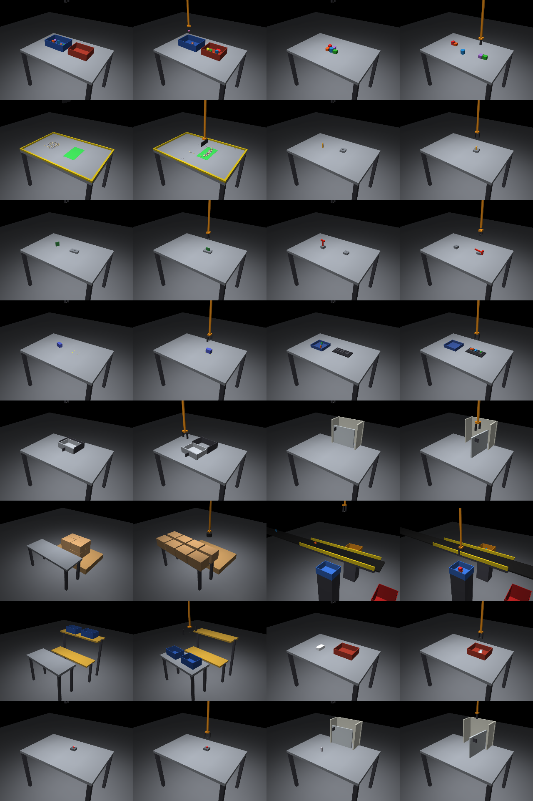

# dynagraph: Typed Physical Memory with Recurrent Refinement for Robot Manipulation

**Jacob Valdez** · work in progress (November 2026) · [MIT License](LICENSE) · paper draft in [`paper/`](paper/)

> **Status.** Research code and an honest, running record of experiments. **All results are in simulation
> (MuJoCo); nothing has been run on a physical robot.** Negative and null results are reported alongside the
> positive ones, and every number below is traceable to a file under `results/` and a section of `docs/`.

<p align="center">
  <br>
  <em>Procedural, site-dressed MuJoCo industrial stations used for closed-loop evaluation.</em>
</p>

## Abstract

Industrial manipulation fails on properties a camera cannot see: how hard a part can be squeezed before it
cracks, how much a snap fit resists, how slippery a lot of pouches is. Robots learn these properties through
contact, and parts in one production lot share them. We study whether a robot that keeps a **typed,
versioned, causal property-graph memory** of such properties, and refines it recurrently with a learned world
model, makes better decisions than robots with generic (untyped) memory, no memory, or a fixed scripted policy.
The memory stores immutable evidence events with explicit revisions, causal availability, duplicate
suppression and provenance. It rejects privileged simulator labels at the actor boundary. A world model reads
that memory, predicts per-skill outcomes (success, slip, damage, effort) with uncertainty, and drives a planner
that may deviate from a scripted anchor only when a lower confidence bound says it is safe. We also adapt a
pretrained looped transformer, **Inkling-2-Mini**, as a fast **System I** controller, entered with a mode token,
while leaving its language-level **System II** behaviour bit-identical. We evaluate on procedural industrial
stations (bin clearing, conveyor sorting, depalletizing, fixture placement, pouch transfer, tool return,
tight snap-fit insertion, fastener picking) with four robots, one held-out robot and one held-out task family,
using pre-registered, paired comparisons with bootstrap confidence intervals.

## Main findings so far

1. **Typed memory beats generic memory in closed loop on every robot**, including the held-out Kinova Gen3:
   +0.05 to +0.39 good parts per lot in the round-5 pre-registered test ([`docs/MODEL_V2.md` §12b](docs/MODEL_V2.md)).
2. **Lot memory pays off when the budget binds.** On a gantry robot with a shared 12-call budget per 5-part lot,
   the typed planner probes 1.1 times per lot instead of 4.9 and beats a strong probe-then-act baseline by
   **+0.09 [+0.03, +0.16]** good parts per lot. Turning lot memory off costs 0.17 [0.11, 0.23].
3. **No win over probe-then-act on the arms** (UR5e, Panda, Gen3): the typed planner still saves 2–2.7 probes per
   lot, but those arms fail for reasons other than budget, so the saved calls have nothing to turn into.
4. **Absolute competence is far from industrial.** Even with the true hidden physics (the labelled oracle), only
   a few robot/task pairs exceed 0.8 success. Examples are UR5e bin clearing at 0.83 and UR5e tight insertion
   with force ramping at 0.90 ([`results/v2/envs/ceiling_r7.md`](results/v2/envs/) on branch `envs-r7`).
5. **Early sprint (compact models and Unitree G1 push):** structure helped prediction under occlusion and
   delay, but the typed friction slot was *not causally used*. No learned model beat a prior stub in the G1
   closed loop ([`docs/findings.md`](docs/findings.md)).

In progress:
- round 6, which adds an ACT imitation baseline and re-evaluates on the fixed fine-motor skills;
- the Inkling System I/II closed-loop comparison, with its language-retention check
  (pre-registered in [`docs/INKLING_SYS12.md`](docs/INKLING_SYS12.md)).

## Method overview

| Component | Where | Summary |
|---|---|---|
| Typed property-graph memory | `src/physmem/memory.py`, `frames.py`, `schema.py` | Immutable evidence, explicit revisions, causal availability, same-source correlation, retraction, provenance, privileged-label rejection |
| World model (v2) | `src/physmem/models/v2/` | Segment encoder over actor-legal force/pose time series. Typed latent slots (e.g. crush force, friction, stiffness) with posterior uncertainty. Outcome heads. Lot memory shared across parts of a lot |
| Planner | `src/physmem/planner.py`, `models/v2/harness.py` | Ranked skill-parameter search anchored on a scripted policy. Deviates only if the LCB beats the anchor. Value-of-information probing. Competence gate from VAL AUC |
| Inkling System I/II | `src/physmem/models/inkling_quant.py`, `sys12.py`, `sys12_train.py` | Quantized Inkling-2-Mini (~21 GB resident). `<sys1>`/`<sys2>` mode tokens. Gated LoRA + memory cross-attention active only in System I. System II logits bit-identical to base |
| Environments | `src/physmem/envs/`, `skills/`, `embodiments/`, `robots/` | Procedural, site-dressed MuJoCo stations with hidden per-part and per-lot physics. Scripted, probe-then-act, force-ramp and labelled-oracle policies |
| Imitation baseline | `src/physmem/models/v2/imitation/` | ACT-style action-chunking policy trained on the same demonstrations |

## Evaluation protocol

- **Pre-registration.** Each round's hypotheses, metrics, thresholds and test seeds are committed on their own,
  before any test run. Errata are committed as found; see the `git log`.
- **Paired evaluation.** Every policy sees identical seeded tasks. Results are reported as paired differences with
  95% bootstrap CIs, n ≥ 30 per cell.
- **Held-out generalization.** The Kinova Gen3 robot and the `drawer_open` family are never trained on.
- **Baselines.** Nominal scripted, probe-then-act (PTA), force-ramp, generic memory, no memory, ACT imitation,
  and a labelled oracle with the true hidden physics, which is reported only as a ceiling.
- **Thresholds** (risk τ, competence gates) are chosen on VAL seeds only.

## Repository layout

```
src/physmem/      memory, world models (compact, v2, Inkling), planner, environments, skills, robots
scripts/          data generation, training, evaluation, rendering (scripts/v2, scripts/sys12)
docs/             design docs and the full experimental record (MODEL_V2.md, ENVS.md, INKLING_SYS12.md, findings.md)
results/          metrics, tables and videos (results/v2/closed_loop, results/v2/videos_paired)
paper/            LaTeX draft
tests/            unit and invariance tests
```

Large artefacts (checkpoints, datasets, the Inkling-2-Mini weights) are not in the repository.

## Quick start

```bash
python -m venv .venv && . .venv/bin/activate
pip install -e .
pytest -q                      # unit + invariance tests
physmem doctor                 # environment check
```

Heavy training and evaluation were run on a single NVIDIA GB10 (≈117 GB unified memory). The Inkling
experiments need the pinned `thinkingmachines/Inkling-2-Mini@b85c3cf` checkpoint, which you download
separately.

## Example: paired closed-loop video

The pre-registered rule renders a paired video only for statistically significant wins.
[`results/v2/videos_paired/pouch_transfer__ur5e_2f85__s2900001.mp4`](results/v2/videos_paired/) shows UR5e
pouch transfer: the scripted heuristic damages the part, and the gated residual planner succeeds at 0.34× the
effort.

<p align="center">
  
</p>

## Citation

```bibtex
@misc{valdez2026dynagraph,
  author = {Valdez, Jacob},
  title  = {dynagraph: Typed Physical Memory with Recurrent Refinement for Robot Manipulation},
  year   = {2026},
  howpublished = {\url{https://github.com/JacobFV/dynagraph}},
  note   = {Work in progress; simulation only}
}
```

## License

MIT. See [LICENSE](LICENSE). Third-party assets, such as MuJoCo Menagerie robot models and the Inkling-2-Mini
weights, are covered by their own licenses.
