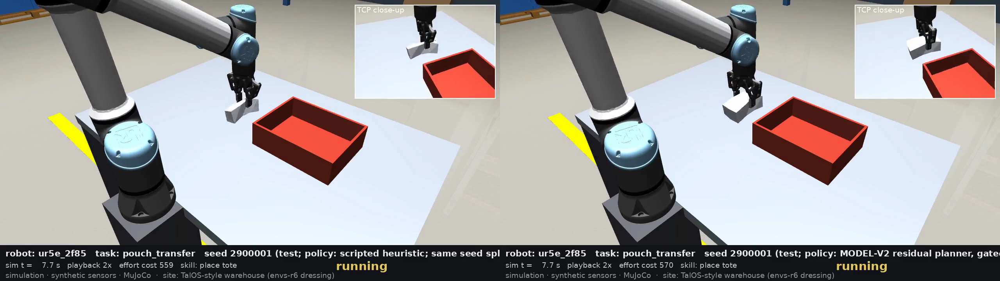

# dynagraph: Typed Physical Memory with Recurrent Refinement for Robot Manipulation

**Jacob Valdez** · work in progress (November 2026) · [MIT License](LICENSE) · paper draft in [`paper/`](paper/)

**New to the project? Start with [`docs/STATUS.md`](docs/STATUS.md)** (orientation, branch map, what's in flight)
and [`docs/RESEARCH_LOG.md`](docs/RESEARCH_LOG.md) (the full dated record).

> **Status.** Research code and an honest, running record of experiments. **All results are in simulation
> (MuJoCo); nothing has been run on a physical robot.** Negative and null results are reported alongside the
> positive ones, and every number below is traceable to a file under `results/` and a section of `docs/`.

<p align="center">
  <br>
  <em>Procedural, site-dressed MuJoCo industrial stations used for closed-loop evaluation.</em>
</p>

## Abstract

General real-world manipulation depends on physical properties no single sensor reveals: mass, friction,
elasticity, crush limits, clearances, and the behaviour of other agents. A robot has to infer them by fusing
**vision, third-person observation, proprioception, force and touch, and digital-twin anchors** (joint encoders,
IMUs, tracked poses, contact points). Our thesis is that the looped core of a pretrained transformer
(**Inkling-2-Mini**) can act as a *hyperdimensional physics engine*. In that view it holds an explicit,
interpretable, editable physical belief state, a typed variable store keyed by entity and property class (MASS,
FRICTION, STIFFNESS, POSE, FORCE, AGENCY, ...). Recurrent attention would update that state in agreement with
rigid-body, friction and Hookean-elastic structure, and anchors would be added, revised and removed as evidence
arrives. We want one model that works across modalities, embodiments and domains, and that generalizes beyond
them. A fast **System I** mode (entered by a mode token) carries that computation, and the language-level
**System II** mode stays intact.

What is built and evaluated so far is a subset:
- a typed, versioned, causal property-graph memory with provenance and privileged-label rejection;
- a world model whose interaction history reaches the decision only through typed slots;
- uncertainty-gated planners;
- the Inkling System I/II adaptation.

All of it is tested in simulation on industrial stations with four robots, a held-out robot and a held-out task,
under pre-registered, paired comparisons. The evaluated observations are actor-legal force/pose interaction series,
entity states and a scalar visual material reading. Third-person tracks, human hands and bodies, and new physical
domains are in progress ([`docs/V3_GENERAL.md`](docs/V3_GENERAL.md)).

## Distance to the thesis (honest status)

- **Not yet built:** a recurrent loop whose *intermediate* states are named physical beliefs. Today the Inkling
  loop refines hidden vectors, and the readout reuses the typed estimates made before the loop
  (`src/physmem/models/inkling.py:494`). The physics losses constrain only final predictions.
- **Not yet shown:**
  - that pretraining helps (pretrained ≈ random-init core);
  - that more loop passes help (1/2/4/8 passes made no difference);
  - that interventions on a named property propagate through belief, action and outcome inside the loop;
  - SE(3) interaction-graph traversal;
  - other-agent modelling;
  - multi-rate streams;
  - any real-world (non-simulated) result.
- **Strongest positive result:** v2 lot memory, a hybrid of an estimator, analytic physics and a planner. It is not
  yet compared against a classical cached-estimate baseline.

The next increment targets this centerpiece ([`docs/V3_GENERAL.md`](docs/V3_GENERAL.md) §0, branch `v3-model`). First
results on a small contact-chain family:
- The pre-registered per-pass belief store with law losses **fails** the causal test on TEST. Editing a named
  property moves predicted motion in the physically correct direction only 52% of the time, which is chance.
- An exploratory variant trained on simulator do()-pairs, with a rollout that cannot bypass the beliefs, makes the
  beliefs causal on VAL: edit direction 0.94, intermediate states 0.98/0.94, and an outcome gain of −4.7 mm
  [−7.4, −2.2]. It fails the chosen-action criterion (0.63 against a 0.80 bar; the classical estimator gets 0.73–0.79,
  the oracle 0.82).
- Its fresh-seed test is pre-registered and has not run yet.

## Main findings so far

1. **Typed memory beats generic memory in closed loop on every robot**, including the held-out Kinova Gen3:
   +0.05 to +0.39 good parts per lot in the round-5 pre-registered test ([`docs/MODEL_V2.md` §12b](docs/MODEL_V2.md)).
2. **Lot memory pays off when the budget binds.** On a gantry robot with a shared 12-call budget per 5-part lot,
   the typed planner probes 1.1 times per lot instead of 4.9 and beats a strong probe-then-act baseline by
   **+0.09 [+0.03, +0.16]** good parts per lot. Turning lot memory off costs 0.17 [0.11, 0.23].
3. **No win over probe-then-act on the arms** (UR5e, Panda, Gen3): the typed planner still saves 2–2.7 probes per
   lot, but those arms fail for reasons other than budget, so the saved calls have nothing to turn into.
4. **Absolute competence is far from industrial.** Even with the true hidden physics (the labelled oracle), only
   a few robot/task pairs exceed 0.8 success. Examples are UR5e bin clearing at 0.83 and UR5e tight insertion
   with force ramping at 0.90 ([`results/v2/envs/ceiling_r7.md`](results/v2/envs/) on branch `envs-r7`).
5. **Early sprint (compact models and Unitree G1 push):** structure helped prediction under occlusion and
   delay, but the typed friction slot was *not causally used*. No learned model beat a prior stub in the G1
   closed loop ([`docs/findings.md`](docs/findings.md)).

In progress:
- round 6, which adds an ACT imitation baseline and re-evaluates on the fixed fine-motor skills;
- the Inkling System I/II closed-loop comparison, with its language-retention check
  (pre-registered in [`docs/INKLING_SYS12.md`](docs/INKLING_SYS12.md)).

## Method overview

| Component | Where | Summary |
|---|---|---|
| Typed property-graph memory | `src/physmem/memory.py`, `frames.py`, `schema.py` | Immutable evidence, explicit revisions, causal availability, same-source correlation, retraction, provenance, privileged-label rejection |
| World model (v2) | `src/physmem/models/v2/` | Segment encoder over actor-legal force/pose time series. Typed latent slots (e.g. crush force, friction, stiffness) with posterior uncertainty. Outcome heads. Lot memory shared across parts of a lot |
| Planner | `src/physmem/planner.py`, `models/v2/harness.py` | Ranked skill-parameter search anchored on a scripted policy. Deviates only if the LCB beats the anchor. Value-of-information probing. Competence gate from VAL AUC |
| Inkling System I/II | `src/physmem/models/inkling_quant.py`, `sys12.py`, `sys12_train.py` | Quantized Inkling-2-Mini (~21 GB resident). `<sys1>`/`<sys2>` mode tokens. Gated LoRA + memory cross-attention active only in System I. System II logits bit-identical to base |
| Environments | `src/physmem/envs/`, `skills/`, `embodiments/`, `robots/` | Procedural, site-dressed MuJoCo stations with hidden per-part and per-lot physics. Scripted, probe-then-act, force-ramp and labelled-oracle policies |
| Imitation baseline | `src/physmem/models/v2/imitation/` | ACT-style action-chunking policy trained on the same demonstrations |

## Evaluation protocol

- **Pre-registration.** Each round's hypotheses, metrics, thresholds and test seeds are committed on their own,
  before any test run. Errata are committed as found; see the `git log`.
- **Paired evaluation.** Every policy sees identical seeded tasks. Results are reported as paired differences with
  95% bootstrap CIs, n ≥ 30 per cell.
- **Held-out generalization.** The Kinova Gen3 robot and the `drawer_open` family are never trained on.
- **Baselines.** Nominal scripted, probe-then-act (PTA), force-ramp, generic memory, no memory, ACT imitation,
  and a labelled oracle with the true hidden physics, which is reported only as a ceiling.
- **Thresholds** (risk τ, competence gates) are chosen on VAL seeds only.

## Repository layout

```
src/physmem/      memory, world models (compact, v2, Inkling), planner, environments, skills, robots
scripts/          data generation, training, evaluation, rendering (scripts/v2, scripts/sys12)
docs/             design docs and the full experimental record (MODEL_V2.md, ENVS.md, INKLING_SYS12.md, findings.md)
results/          metrics, tables and videos (results/v2/closed_loop, results/v2/videos_paired)
paper/            LaTeX draft
tests/            unit and invariance tests
```

Large artefacts (checkpoints, datasets, the Inkling-2-Mini weights) are not in the repository.

## Quick start

```bash
python -m venv .venv && . .venv/bin/activate
pip install -e .
pytest -q                      # unit + invariance tests
physmem doctor                 # environment check
```

Heavy training and evaluation were run on a single NVIDIA GB10 (≈117 GB unified memory). The Inkling
experiments need the pinned `thinkingmachines/Inkling-2-Mini@b85c3cf` checkpoint, which you download
separately.

## Example: paired closed-loop video

The pre-registered rule renders a paired video only for statistically significant wins.
[`results/v2/videos_paired/pouch_transfer__ur5e_2f85__s2900001.mp4`](results/v2/videos_paired/) shows UR5e
pouch transfer: the scripted heuristic damages the part, and the gated residual planner succeeds at 0.34× the
effort.

<p align="center">
  
</p>

## Citation

```bibtex
@misc{valdez2026dynagraph,
  author = {Valdez, Jacob},
  title  = {dynagraph: Typed Physical Memory with Recurrent Refinement for Robot Manipulation},
  year   = {2026},
  howpublished = {\url{https://github.com/JacobFV/dynagraph}},
  note   = {Work in progress; simulation only}
}
```

## License

MIT. See [LICENSE](LICENSE). Third-party assets, such as MuJoCo Menagerie robot models and the Inkling-2-Mini
weights, are covered by their own licenses.
